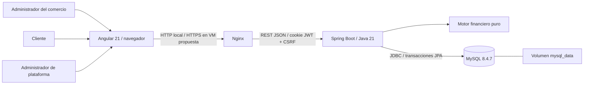
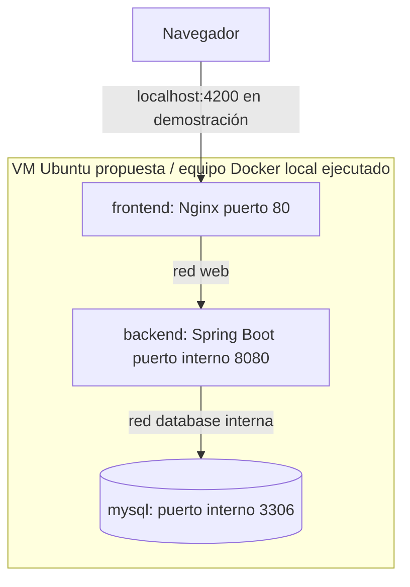

# Arquitectura implementada

La aplicación utiliza tres capas físicas: Angular servido por Nginx, API monolítica Spring Boot y MySQL. El backend se organiza por contextos iam, stores, customers, catalog, sales, finance, payments, accounts, reporting, support y shared. Los calculadores puros se encuentran en finance/domain; la lógica transaccional de ventas y pagos está en application; la exposición HTTP, en api.

La persistencia compartida se implementa mediante JPA, el repositorio Data y las entidades Model. Spring Data JPA proporciona la integración del contexto de persistencia, sin crear repositorios triviales por tabla. Se utiliza un repositorio pequeño y explícito para esta primera implementación. Los controladores de mantenimiento utilizan transacciones para sus operaciones sencillas; ventas y pagos tienen servicios de aplicación propios.

Los recursos son autorizados en Access. Los identificadores enviados por el navegador no conceden permisos. La cuenta se bloquea mediante SELECT FOR UPDATE y se refresca después del bloqueo, para evitar el uso de entidades cargadas antes de esperar a otra transacción. Se usa READ_COMMITTED. Las claves de idempotencia se verifican contra un hash de la solicitud y restricciones únicas en la base de datos.

El despliegue ejecutado se verifica en docs/evidencias. No se ha desplegado en una VM externa ni se ha contratado infraestructura.
