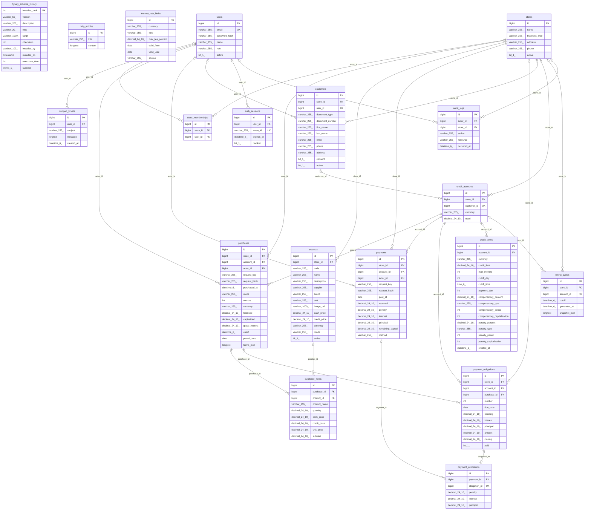

# Modelo definitivo de base de datos

Este diccionario y el diagrama se generan consultando information_schema de la instancia MySQL ejecutada, mediante scripts/collect-evidence.cjs. Los resultados originales se conservan en docs/evidencias/esquema-real.tsv y relaciones-reales.tsv. Flyway aplica V1 y V2; Hibernate valida las entidades.

## audit_logs

Columna | Tipo real | Permite NULL | Clave
---|---|---|---
id | bigint | No | PRI
actor_id | bigint | Sí | MUL
store_id | bigint | Sí | MUL
action | varchar(255) | Sí | —
resource | varchar(255) | Sí | —
occurred_at | datetime(6) | Sí | —
## auth_sessions

Columna | Tipo real | Permite NULL | Clave
---|---|---|---
id | bigint | No | PRI
user_id | bigint | Sí | MUL
token_id | varchar(255) | Sí | UNI
expires_at | datetime(6) | Sí | MUL
revoked | bit(1) | No | —
## billing_cycles

Columna | Tipo real | Permite NULL | Clave
---|---|---|---
id | bigint | No | PRI
store_id | bigint | Sí | MUL
account_id | bigint | Sí | MUL
cutoff | datetime(6) | Sí | —
generated_at | datetime(6) | Sí | —
snapshot_json | longtext | Sí | —
## credit_accounts

Columna | Tipo real | Permite NULL | Clave
---|---|---|---
id | bigint | No | PRI
store_id | bigint | Sí | MUL
customer_id | bigint | Sí | UNI
currency | varchar(255) | Sí | —
used | decimal(24,10) | Sí | —
## credit_terms

Columna | Tipo real | Permite NULL | Clave
---|---|---|---
id | bigint | No | PRI
account_id | bigint | Sí | MUL
currency | varchar(255) | Sí | —
credit_limit | decimal(24,10) | Sí | —
max_months | int | No | —
cutoff_day | int | No | —
cutoff_time | time(6) | Sí | —
payment_day | int | No | —
compensatory_percent | decimal(24,10) | Sí | —
compensatory_type | varchar(255) | Sí | —
compensatory_period | int | No | —
compensatory_capitalization | int | No | —
penalty_percent | decimal(24,10) | Sí | —
penalty_type | varchar(255) | Sí | —
penalty_period | int | No | —
penalty_capitalization | int | No | —
created_at | datetime(6) | Sí | —
## customers

Columna | Tipo real | Permite NULL | Clave
---|---|---|---
id | bigint | No | PRI
store_id | bigint | Sí | MUL
user_id | bigint | Sí | MUL
document_type | varchar(255) | Sí | —
document_number | varchar(255) | Sí | —
first_name | varchar(255) | Sí | —
last_name | varchar(255) | Sí | —
email | varchar(255) | Sí | —
phone | varchar(255) | Sí | —
address | varchar(255) | Sí | —
consent | bit(1) | No | —
active | bit(1) | No | —
## flyway_schema_history

Columna | Tipo real | Permite NULL | Clave
---|---|---|---
installed_rank | int | No | PRI
version | varchar(50) | Sí | —
description | varchar(200) | No | —
type | varchar(20) | No | —
script | varchar(1000) | No | —
checksum | int | Sí | —
installed_by | varchar(100) | No | —
installed_on | timestamp | No | —
execution_time | int | No | —
success | tinyint(1) | No | MUL
## help_articles

Columna | Tipo real | Permite NULL | Clave
---|---|---|---
id | bigint | No | PRI
title | varchar(255) | Sí | —
content | longtext | Sí | —
## interest_rate_limits

Columna | Tipo real | Permite NULL | Clave
---|---|---|---
id | bigint | No | PRI
currency | varchar(255) | Sí | MUL
kind | varchar(255) | Sí | —
max_tea_percent | decimal(24,10) | Sí | —
valid_from | date | Sí | —
valid_until | date | Sí | —
source | varchar(255) | Sí | —
## payment_allocations

Columna | Tipo real | Permite NULL | Clave
---|---|---|---
id | bigint | No | PRI
payment_id | bigint | Sí | MUL
obligation_id | bigint | Sí | UNI
penalty | decimal(24,10) | Sí | —
interest | decimal(24,10) | Sí | —
principal | decimal(24,10) | Sí | —
## payment_obligations

Columna | Tipo real | Permite NULL | Clave
---|---|---|---
id | bigint | No | PRI
store_id | bigint | Sí | MUL
account_id | bigint | Sí | MUL
purchase_id | bigint | Sí | MUL
number | int | No | —
due_date | date | Sí | —
opening | decimal(24,10) | Sí | —
interest | decimal(24,10) | Sí | —
principal | decimal(24,10) | Sí | —
amount | decimal(24,10) | Sí | —
closing | decimal(24,10) | Sí | —
paid | bit(1) | No | —
## payments

Columna | Tipo real | Permite NULL | Clave
---|---|---|---
id | bigint | No | PRI
store_id | bigint | No | MUL
account_id | bigint | No | MUL
actor_id | bigint | Sí | MUL
request_key | varchar(255) | No | —
request_hash | varchar(255) | Sí | —
paid_at | date | Sí | —
received | decimal(24,10) | Sí | —
penalty | decimal(24,10) | Sí | —
interest | decimal(24,10) | Sí | —
principal | decimal(24,10) | Sí | —
remaining_capital | decimal(24,10) | Sí | —
method | varchar(255) | Sí | —
## products

Columna | Tipo real | Permite NULL | Clave
---|---|---|---
id | bigint | No | PRI
store_id | bigint | Sí | MUL
code | varchar(255) | Sí | —
name | varchar(255) | Sí | —
description | varchar(255) | Sí | —
supplier | varchar(255) | Sí | —
brand | varchar(255) | Sí | —
unit | varchar(255) | Sí | —
image_url | varchar(1000) | Sí | —
cash_price | decimal(24,10) | Sí | —
credit_price | decimal(24,10) | Sí | —
currency | varchar(255) | Sí | —
mode | varchar(255) | Sí | —
active | bit(1) | No | —
## purchase_items

Columna | Tipo real | Permite NULL | Clave
---|---|---|---
id | bigint | No | PRI
purchase_id | bigint | Sí | MUL
product_id | bigint | Sí | MUL
product_name | varchar(255) | Sí | —
quantity | decimal(24,10) | Sí | —
cash_price | decimal(24,10) | Sí | —
credit_price | decimal(24,10) | Sí | —
unit_price | decimal(24,10) | Sí | —
subtotal | decimal(24,10) | Sí | —
## purchases

Columna | Tipo real | Permite NULL | Clave
---|---|---|---
id | bigint | No | PRI
store_id | bigint | No | MUL
account_id | bigint | No | MUL
actor_id | bigint | Sí | MUL
request_key | varchar(255) | No | —
request_hash | varchar(255) | Sí | —
purchased_at | datetime(6) | Sí | —
mode | varchar(255) | Sí | —
months | int | No | —
currency | varchar(255) | Sí | —
financed | decimal(24,10) | Sí | —
capitalized | decimal(24,10) | Sí | —
grace_interest | decimal(24,10) | Sí | —
cutoff | datetime(6) | Sí | —
period_zero | date | Sí | —
terms_json | longtext | No | —
## store_memberships

Columna | Tipo real | Permite NULL | Clave
---|---|---|---
id | bigint | No | PRI
store_id | bigint | Sí | MUL
user_id | bigint | Sí | MUL
## stores

Columna | Tipo real | Permite NULL | Clave
---|---|---|---
id | bigint | No | PRI
name | varchar(255) | No | —
business_type | varchar(255) | No | —
address | varchar(255) | Sí | —
phone | varchar(255) | Sí | —
active | bit(1) | No | —
## support_tickets

Columna | Tipo real | Permite NULL | Clave
---|---|---|---
id | bigint | No | PRI
user_id | bigint | Sí | MUL
subject | varchar(255) | Sí | —
message | longtext | Sí | —
created_at | datetime(6) | Sí | —
## users

Columna | Tipo real | Permite NULL | Clave
---|---|---|---
id | bigint | No | PRI
email | varchar(255) | No | UNI
password_hash | varchar(255) | No | —
name | varchar(255) | Sí | —
role | varchar(255) | No | —
active | bit(1) | No | —

## Persistencia e integridad

Las compras mantienen condiciones históricas completas en terms_json y precios originales en purchase_items. credit_terms mantiene versiones append-only de condiciones actuales. Los cronogramas son payment_obligations; los pagos se descomponen en payment_allocations, con unicidad de obligación cancelada. billing_cycles conserva instantáneas por cuenta/corte. Roles se modelan como valores cerrados en users.role; cada producto tiene una imagen URL. No se requiere duplicar cuotas, roles o imágenes en tablas adicionales.

Las claves únicas de operación incluyen tienda y request_key. Las membresías y documentos se validan por tienda. Las claves foráneas complementan la autorización del backend; no reemplazan las comprobaciones de Access. READ_COMMITTED, bloqueo pesimista y refresco de cuenta protegen los saldos concurrentes. No se borran operaciones financieras.

Las restricciones CHECK, índices y claves compuestas se consultan en [migraciones Flyway](../backend/src/main/resources/db/migration). El procedimiento SQL de comprobación se encuentra en [sql-evidence.sql](../scripts/sql-evidence.sql).

## Diagrama entidad-relación

